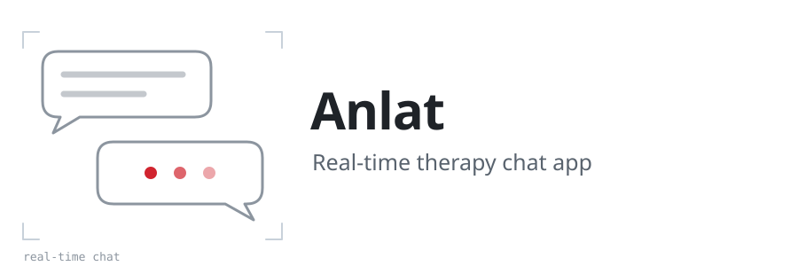
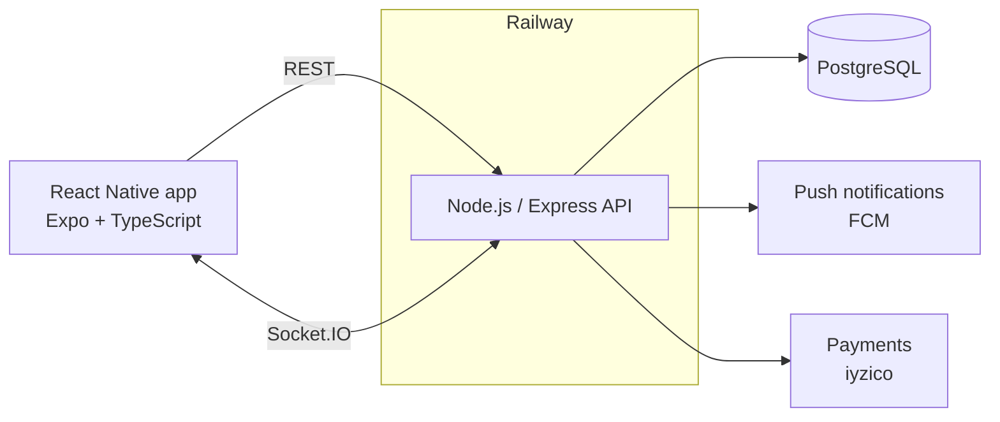

<picture>
  <source media="(prefers-color-scheme: dark)" srcset="assets/header-dark.svg">
  
</picture>

**Live on [Google Play](https://play.google.com/store/apps/details?id=com.anlatmamlazim.therapy) and the App Store**

Anlat is a mobile app that connects clients with psychologists and lets them talk through real-time messaging. I built it as a freelance project in React Native and took it from development to production on both stores, including the backend that runs in Docker on Railway.

> This is a showcase repository. Anlat is a client project, so its source code is private; this page describes what the app does and how it is built.

<!--
## Screenshots

Add PNGs to docs/screenshots/ and uncomment this section.

  
  
  

-->

## What it does

- Separate client and psychologist roles, chosen at sign-up.
- An onboarding flow with the Kessler psychological distress test.
- Psychologist listings and profile pages.
- Appointment requests that the psychologist approves.
- Real-time one-to-one messaging.
- Ratings and complaints after a session.
- In-app payments and push notifications.
- Admin screens for users, psychologists, complaints, payments and statistics.

## How it works

The mobile app talks to the backend over REST for regular requests and keeps a Socket.IO connection open for chat, so messages arrive without polling. The backend is a Node.js and Express API with JWT authentication, request validation, rate limiting and security headers, backed by PostgreSQL. It is packaged as a Docker image and deployed to Railway through a CI/CD pipeline.

## Tech stack

- **Mobile:** React Native · Expo · TypeScript · Expo Router · Socket.IO client
- **Backend:** Node.js · Express · Socket.IO · PostgreSQL · JWT
- **Infrastructure:** Docker · Railway · CI/CD · Firebase Cloud Messaging · iyzico

## Running it

The source code is not public, so the app cannot be built from this repository. To try Anlat, install it from [Google Play](https://play.google.com/store/apps/details?id=com.anlatmamlazim.therapy) or the App Store.

## Contact

Ulaş Uçan · [LinkedIn](https://www.linkedin.com/in/ula%C5%9F-u%C3%A7an-36531626b) · [uls.ucn@gmail.com](mailto:uls.ucn@gmail.com)
